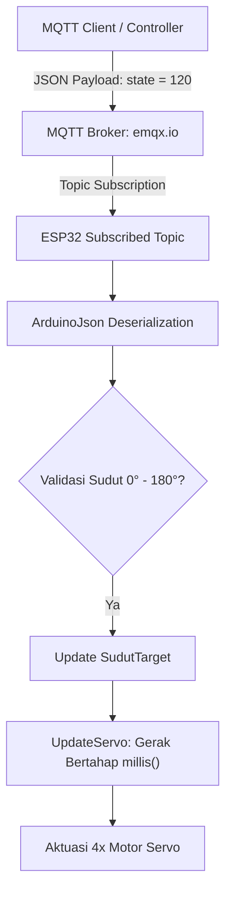

# 🦾 Robotic Arm Telemetry via MQTT & JSON Parsing

Sistem kendali jarak jauh lengan robot (*Robotic Arm*) multi-DOF berbasis mikrokontroler **ESP32** menggunakan protokol **MQTT**. Sistem ini menerima payload data berformat JSON (**ArduinoJson**), melakukan parsing parameter sudut secara dinamis, serta mengeksekusi pergerakan sendi servo secara bertahap agar pergerakan lengan terasa halus (*smooth motion*).

## 🧠 System Architecture & Features

- **JSON Payload Parsing**: Memproses data string berformat JSON yang diterima dari broker MQTT secara aman menggunakan pustaka ArduinoJson.
- **Non-Blocking Smooth Motion**: Menggunakan perulangan berbasis waktu (`millis()`) untuk menggeser posisi servo secara bertahap (`SudutSekarang` menuju `SudutTarget`) dengan interval waktu tertentu, mencegah hentakan mekanis pada lengan robot.
- **Multi-DOF Control**: Mengendalikan 4 aktuator utama secara independen (Lengan Kanan, Lengan Kiri, Capit, dan Basis Bawah).
- **Auto-Reconnect Mechanism**: Dilengkapi pemantauan koneksi otomatis untuk WiFi dan MQTT agar sistem tetap responsif apabila jaringan terputus.

## 📌 Pin Mapping & Hardware Configuration

| Komponen / Sendi | Pin ESP32 / Keterangan |
|---|---|
| Servo Kanan (`kanan`) | Pin 13 (Default: 90°) |
| Servo Kiri (`kiri`) | Pin 14 (Default: 90°) |
| Servo Capit (`capit`) | Pin 25 (Default: 90°) |
| Servo Bawah (`bawah`) | Pin 26 (Default: 90°) |

## 🔄 System Data Flow & MQTT Structure

**Broker:** `broker.emqx.io` : `1883`



## 📡 MQTT Topics & Payload Format

**Format payload JSON yang dikirim:**

```json
{
  "state": 135
}
```

Nilai sudut valid berada pada rentang 0 hingga 180 derajat.

**Daftar topik MQTT:**

| Topik (Command) | Topik (Status Publish) | Fungsi / Keterangan |
|---|---|---|
| `robot/servo/kanan` | `robot/kanan/status` | Mengontrol sudut servo lengan kanan |
| `robot/servo/kiri` | `robot/kiri/status` | Mengontrol sudut servo lengan kiri |
| `robot/servo/capit` | `robot/capit/status` | Mengontrol sudut servo cengkeram capit |
| `robot/servo/bawah` | `robot/bawah/status` | Mengontrol sudut servo rotasi basis bawah |

## 💻 Software Stack & Libraries

- **Framework:** Arduino / ESP32 Core
- **Libraries:**
  - `ESP32Servo` (Pengendalian PWM Servo)
  - `PubSubClient` (Klien Protokol MQTT)
  - `ArduinoJson` (Deserialisasi payload JSON)
  - `WiFi` (Konektivitas jaringan nirkabel)

## 🚀 Getting Started

1. Klon repository ini atau buat proyek baru di VS Code (PlatformIO) / Arduino IDE.
2. Pastikan pustaka `ArduinoJson` dan `PubSubClient` sudah terinstal.
3. Sesuaikan SSID dan password WiFi pada kode:

   ```cpp
   const char* ssid = "NAMA_WIFI";
   const char* password = "PASSWORD_WIFI";
   ```

4. Kompilasi dan unggah (*upload*) program ke ESP32.
5. Gunakan MQTT client (seperti MQTT Explorer atau script publisher) untuk mengirim perintah berformat JSON ke topik target.